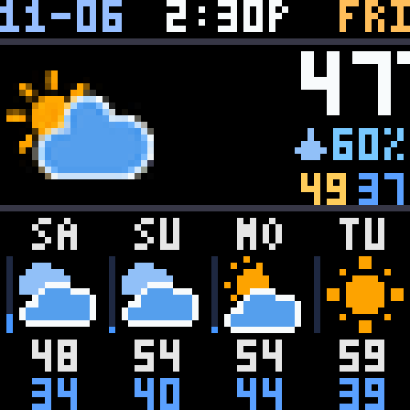
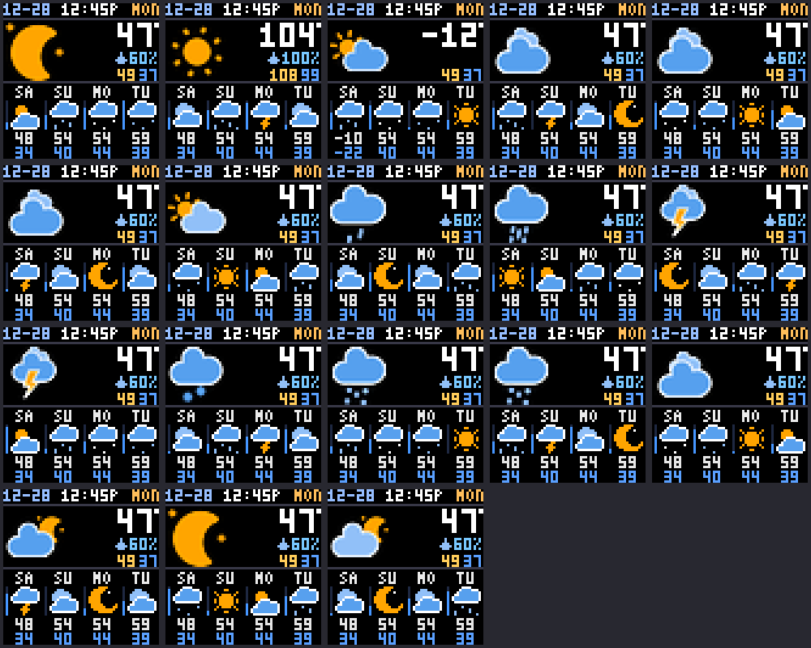

# Pixoo Weather GIF

A Home Assistant app that serves a live, animated 64×64 weather screen for the Divoom Pixoo 64.



The screen shows:

- The date, time and weekday
- An animated icon for current conditions, with temperature and humidity
- Today's high and low
- Today's chance of rain or snow when it's 10% or more, or `FOG` on foggy days
- A blinking warning triangle when weather alerts are active
- A four-day forecast with animated icons, a rain-chance bar, and highs and lows

Every weather condition has its own icon, with day and night versions where they apply:



## How it works

The app reads a `weather.*` entity through the Home Assistant API and draws a new GIF each time one is requested. The GIF has 20 frames at 200 ms each, loops seamlessly, and is about 16 KB. Weather data is cached for 30 seconds. If Home Assistant has a problem, the app keeps serving the last good data.

The GIF is served at `http://<home-assistant-ip>:6943/`. The clock in each GIF is fixed at the moment it was drawn, so it only moves forward when the display fetches the GIF again.

## Install

1. In Home Assistant, go to **Settings → Apps → Install app**, open the **⋮** menu, choose **Repositories**, and add this repository's URL.
2. Install **Pixoo Weather GIF**.
3. Start the app, then open its settings page with **Open web UI** and choose your entities.
4. Open `http://<home-assistant-ip>:6943/` to check the GIF.

## Settings

The settings page runs inside Home Assistant and only answers requests that come through it. It lists your entities, shows the current screen, and applies changes on the Pixoo's next refresh.

| Setting | Description |
|---|---|
| Weather entity | A `weather.*` entity. It must provide a daily forecast; the page checks before saving. |
| Weather alerts sensor | Optional. A sensor whose state is the number of active alerts. The list shows sensors with "alert" in their name. |
| Rain and snow threshold | Default 10%. Today's chance of rain or snow is shown at or above this. Foggy days always show `FOG`. |
| Smiley for low chances | Off by default. Shows a smiley instead of nothing when today's chance is below the threshold. |
| Reading under the temperature | Humidity (default), or the "feels like" temperature with a thermometer icon. Falls back to humidity if the weather entity has no apparent temperature. |
| Clock | 12-hour (default) or 24-hour. |
| Date | Month-day (default) or day-month. |
| Alert icon | Blinking (default) or solid. |

The app's **Configuration** tab has the same settings. They're used as starting values; once you save on the settings page, its values take priority.

## Show it on the Pixoo

This app only serves the GIF, so something else has to tell the Pixoo to play it. The [Divoom Pixoo 64 integration](https://github.com/gickowtf/pixoo-homeassistant) works well. Add a `gif` page to its configuration:

```yaml
- page_type: gif
  gif_url: http://<home-assistant-ip>:6943/
  duration: 55
```

With a single page and no others, set the integration's scan interval to control how often the GIF reloads. The clock only updates on a reload.

## Development

The app and its tests need Python and Pillow, plus `tzdata` on Windows. The app's Docker image uses Python 3.13.

```bash
python tests/test_server.py
```

```bash
python tests/test_render.py
```

```bash
python tools/check.py
```

`tests/test_server.py` runs the server against a mock Home Assistant API. `tests/test_render.py` checks the alert icon, precipitation text and humidity. `tools/check.py` validates the GIF and rebuilds the images in `docs/`.

The 24px icon sprites in `pixoo_weather_gif/sprites` are generated once from the SVGs in `tools/source_icons`, and only need rebuilding if the icons change. That step also needs Playwright and Microsoft Edge:

```bash
python tools/bake_sprites.py
```

## License

The code is under the [MIT License](LICENSE).

The weather icons are by [amCharts](https://www.amcharts.com/free-animated-svg-weather-icons/), under [CC BY 4.0](https://creativecommons.org/licenses/by/4.0/). See [NOTICE.md](NOTICE.md) for details and the changes made to them.

This project is not affiliated with Divoom, amCharts or Home Assistant.
